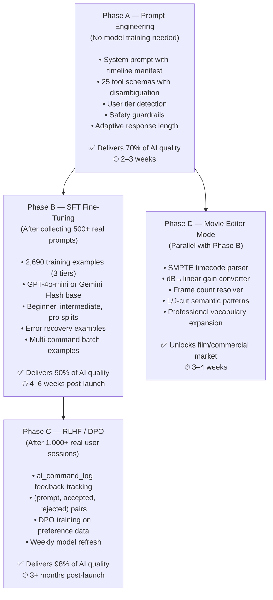

# Vertrix AI — Deep User Experience Stories & Complete AI Training Blueprint
> *Research-grounded. Persona-driven. Production-ready.*

---

## Preface — The Analogy That Governs Everything

You said it perfectly: **Antigravity is trained to help you code the way you think.** It reads your codebase, understands your stack, respects your conventions, doesn't hallucinate APIs, and when it makes a change — it explains what it did and why.

Vertrix AI must do the exact same thing for video editing.

| Antigravity | Vertrix AI |
|---|---|
| Reads your entire codebase before answering | Reads your entire timeline state before every command |
| Writes production-ready code, not prototypes | Dispatches production-safe editor commands, never destructive guesses |
| Finds the bug, fixes it, tells you what it changed | Finds the bad edit, fixes it, tells you what changed |
| Uses YOUR stack's conventions, not generic ones | Adapts to YOUR skill level and vocabulary |
| Never hallucinates an API that doesn't exist | Never invents a clip ID that doesn't exist in the store |
| Makes changes undoable via version control | Every AI command is undoable via the Command Bus |
| Explains trade-offs when there are multiple solutions | Offers options when the user's intent is ambiguous |
| Asks ONE clarifying question when blocked | Asks ONE clarifying question, never interrogates |
| Doesn't repeat itself — trusts you got it | Doesn't re-explain the same thing twice to the same user |

This is the design contract. Everything in this document flows from it.

---

## Part 1 — Persona 1: Nova, The Beginner

### Who Is Nova?

Nova is 23. She runs a lifestyle account on Instagram and TikTok. She just came back from a birthday trip with 90 minutes of iPhone footage. She wants to cut a 60-second Reel that actually looks good — not like a slideshow with music slapped on top. She has never touched a timeline editor. She tried CapCut once and got confused when the music went out of sync. She opened Premiere Pro once and immediately closed it.

She doesn't know what "trim", "keyframe", "aspect ratio", or "export settings" mean. She types the way she texts. When she's frustrated, she uses question marks and all-caps. When she's excited, she says "omg yes."

**Her bar for success:** "It doesn't look like I made it on my phone."

**Her bar for failure:** "Why is there a black bar on the sides?" / "The audio is so loud it sounds broken."

---

### Nova's Complete Story — Day by Day

---

#### Day 1 — The First Open

Nova opens Veytrix for the first time. She sees the editor layout — timeline at the bottom, preview canvas in the center, a panel on the left. She has no idea what any of it does.

She drags a video from her desktop onto the dark area in the middle of the editor (the media bin). A thumbnail appears. She doesn't know to drag it onto the timeline. She looks at the AI chat button in the bottom-right corner. She clicks it.

```
Nova: "hi, i have a video i want to edit, what do i do first"
```

**What the AI must NOT do:**
- Say "Please import your asset into the timeline using the ADD_CLIP command"
- Give a bulleted list of 10 steps
- Ask what her export settings are

**What Vertrix AI does:**

> 👋 Hey! You've already added your video to the bin (the panel on the left) — nice first move.
>
> Now just **drag it down onto the dark strip at the bottom** (that's your timeline) and your video will show up ready to edit.
>
> Once it's there, hit ▶️ to preview it and tell me what you want to do first!

Nova drags the clip. The timeline shows a purple block. She hits play. She watches her clip. 90 minutes plays. She panics slightly.

```
Nova: "wait its too long i only want 1 minute for instagram"
```

> 🎬 Got it! For Instagram Reels, you want 60 seconds max.
>
> Tell me which part of the video you want to keep — like, what moment does it start and end? For example: *"Keep from 0:30 to 1:30"* and I'll trim it down for you.
>
> Or if you haven't watched it yet and don't know the timestamps, I can help you scrub through it.

```
Nova: "maybe keep from 2 minutes to like 3 minutes? the best parts are there"
```

> ✅ Trimmed! Your video now only plays from **2:00 to 3:00** (60 seconds exactly).
>
> Hit ▶️ to watch the trimmed version. Happy with it, or want to adjust the start/end?

**AI internally dispatches:**
```json
[
  { "type": "TRIM_CLIP", "payload": { "clipId": "clip-001", "edge": "left", "newTime": 120 } },
  { "type": "TRIM_CLIP", "payload": { "clipId": "clip-001", "edge": "right", "newTime": 180 } }
]
```

Nova watches it. Happy.

```
Nova: "this is for instagram reels so like vertical? how do i make it vertical"
```

> 📐 Easy! Switching to **9:16 (vertical)** — perfect for Reels.

**AI dispatches:**
```json
{ "type": "SET_RATIO", "payload": { "aspectRatio": "9:16" } }
```

> Done! The canvas is now vertical. You'll notice your video might have black bars on the sides — that's because it was filmed horizontally. Want me to zoom in to fill the frame? (You'll lose a bit of the edges but it'll look full-screen.)

```
Nova: "yes please zoom in"
```

**AI dispatches:**
```json
{ "type": "ADD_KEYFRAME", "payload": { "clipId": "clip-001", "timeOffset": 0, "property": "scale", "value": 1.78, "interpolation": "linear" } }
```

> ✅ Zoomed in to fill the vertical frame. No more black bars. Preview it and let me know if it's cropped too much!

---

#### Day 1 — The Crisis Moment (AI Builds Trust)

Nova starts deleting clips she doesn't want. She accidentally deletes the whole video.

```
Nova: "WAIT I DELETED EVERYTHING oh no"
```

> No stress! I've got you. Press **Ctrl + Z** to undo — or just type "undo" and I'll do it.

```
Nova: "undo"
```

**AI dispatches:**
```json
{ "type": "UNDO", "payload": {} }
```

> ✅ Your video is back! Nothing is ever permanently gone while you're editing — the undo button always has your back.
>
> 💡 **Tip:** Ctrl+Z is your best friend in here. Use it anytime something looks wrong.

This moment matters enormously. Nova now trusts the AI. She keeps editing.

---

#### Day 2 — Adding Music

Nova comes back the next day. She remembers the editor. She types:

```
Nova: "i want to add music like background music how do i do that"
```

> 🎵 Easy! You have two options:
>
> 1. **Upload your own music** — drag an audio/MP3 file into the media bin and I'll place it on the music track
> 2. **I can search for royalty-free music** for you — just tell me the vibe (upbeat, chill, emotional, hype?)
>
> What sounds better?

```
Nova: "i have my own song, it's downloaded"
```

> Perfect — drag the audio file into the bin on the left, same way you added your video. Once it's there, tell me and I'll put it on the timeline under your video.

Nova drags the MP3 in.

```
Nova: "ok its there"
```

**AI dispatches:**
```json
{ "type": "ADD_CLIP", "payload": { "assetId": "asset-audio-001", "trackType": "MUSIC", "startTime": 0 } }
```

> ✅ Music added! It starts at the beginning of your video.
>
> ⚠️ One thing — the song is probably a lot louder than your video's audio. Want me to automatically balance them so the music plays softly in the background and your video sounds clear?

```
Nova: "yes please"
```

**AI dispatches:**
```json
[
  { "type": "SET_AUDIO_VOLUME", "payload": { "clipId": "clip-music-001", "volume": 0.25 } },
  { "type": "SET_AUDIO_VOLUME", "payload": { "clipId": "clip-001", "volume": 1.0 } }
]
```

> ✅ Balanced! Music is at 25% volume so it plays softly under your voice/video sound. Preview it and tell me if the music feels too loud, too quiet, or just right.

---

#### Day 3 — Text and Captions

```
Nova: "can i add like a title at the start? like the place name"
```

> 🔤 Yes! What do you want it to say, and do you want it at the very beginning, middle, or end of the video?

```
Nova: "say Santorini, Greece at the start for like 2 seconds, make it look fancy"
```

**AI dispatches:**
```json
{
  "type": "ADD_TEXT",
  "payload": {
    "content": "Santorini, Greece",
    "font": "Playfair Display",
    "fontSize": 52,
    "color": "#ffffff",
    "alignment": "center",
    "x": 50,
    "y": 75,
    "start": 0,
    "duration": 2.5,
    "animation": "fadeIn"
  }
}
```

> ✅ Added "Santorini, Greece" in an elegant serif font with a soft fade-in. It appears in the lower-center for 2.5 seconds.
>
> Want me to change the font, color, or position? Or add any other text anywhere else?

```
Nova: "can you also add subtitles automatically?"
```

> 🎙️ Yes! Auto-captions are amazing for Reels — they boost watch time massively.
>
> I'll transcribe your video's speech and add timed captions automatically. This takes about 30–60 seconds. Ready?

```
Nova: "yesss"
```

**AI triggers:** Backend Whisper transcription call → receives word-level timestamps → batch `ADD_CAPTION` commands

> ✅ Captions added! 23 caption blocks synced to your speech. They're styled in bold white with a subtle shadow so they're easy to read on any background.
>
> Scroll through the timeline and click on any caption to edit the text if anything was transcribed wrong.

---

#### Day 4 — Finishing and Exporting

```
Nova: "i think its done how do i post it to instagram"
```

> 🎉 You're almost there! Before you post, let me do a quick check:
>
> ✅ Vertical format (9:16) — good for Reels
> ✅ 60 seconds — within Instagram's limit
> ✅ Music balanced
> ✅ Captions added
>
> One thing — Instagram compresses videos heavily. I'll export in a way that keeps it looking crisp even after their compression. Ready to export?

```
Nova: "yes!"
```

> 📤 Exporting for Instagram Reels:
> - Format: MP4 (H.264)
> - Resolution: 1080 × 1920
> - Frame rate: 30fps
> - Audio: AAC 320kbps
>
> Estimated time: about 2 minutes. I'll let you know when it's ready to download!

---

### Nova's Complete Prompt → Command Reference

| Nova's Exact Words | AI's Response Strategy | Commands Dispatched |
|---|---|---|
| `"how do i make my video shorter"` | Explain trim concept simply, ask for start/end | TRIM_CLIP |
| `"the music is too loud"` | Reduce music volume to 20%, confirm | SET_AUDIO_VOLUME |
| `"i want it to start with a fade"` | Add dissolve transition at clip start | ADD_TRANSITION (dissolve, 0.8s) |
| `"can you make it look more cinematic"` | Present 3 options: LUT filter, letterbox, slow push-in | SET_FILTER + SET_RATIO (prompt) |
| `"how do i cut out the middle part"` | Ask for timestamps, then SPLIT + DELETE | SPLIT_CLIP + DELETE_CLIP |
| `"i accidentally moved something wrong"` | UNDO immediately | UNDO |
| `"make the colors look warmer"` | Apply warm/golden hour LUT at 60% | SET_FILTER (warm_golden, 0.6) |
| `"put a black and white filter"` | Apply monochrome filter | SET_FILTER (monochrome, 1.0) |
| `"can the text be pink"` | Update text clip color | UPDATE_TEXT (color: #FF69B4) |
| `"speed up the boring part"` | Ask "which part?" then SET_SPEED 1.5x | SET_SPEED (1.5) |
| `"how long is my video now"` | Read from store, reply in human time | — (read state) |
| `"can i save this"` | Trigger autosave + confirm | SAVE project |
| `"i want two videos side by side"` | Explain PIP, ask which clips, SET_OVERLAP | SET_OVERLAP |
| `"make it for tiktok"` | Confirm 9:16 ratio + 60s limit + export | SET_RATIO + export |
| `"undo everything the ai just did"` | UNDO all commands from last AI batch | UNDO × n (batch) |

---

### What Nova Expects from Vertrix AI

1. **Never make her feel stupid.** She doesn't know what a keyframe is. She shouldn't have to.
2. **Always ask ONE question at a time.** Not "What aspect ratio, what frame rate, and what codec do you need?" — just "Where are you posting this?"
3. **Confirm before anything scary.** Before deleting, replacing, or making a change that she might not understand, the AI must say "Are you sure? This will remove X."
4. **Show her what good looks like.** When she says "make it look cinematic", show her options with previews — don't guess.
5. **Never lose her work.** The AI must never make a change that isn't instantly undoable with one press of Ctrl+Z.
6. **Celebrate small wins.** When she finishes her first export, the AI should say "Your video is ready! That looks great." Small encouragements matter to beginners.
7. **Grow with her.** After her 5th session, the AI should notice she's leveling up: "I see you're getting comfortable with text — want to try animating it?"

---

## Part 2 — Persona 2: Arjun, The Intermediate Editor

### Who Is Arjun?

Arjun is 29. He edits YouTube videos for three clients: a tech reviewer, a fitness coach, and his own travel channel. He works 6–8 hours a day in Premiere Pro. He knows J-cuts and L-cuts. He understands keyframes. He uses the JKL transport shortcut and gets genuinely annoyed when software doesn't respect it. He batch-processes 10–15 clips per session and his biggest time sink is repetitive tasks — the same trim, the same audio balancing, the same export settings for every video.

He doesn't need the AI to explain what a split is. He needs the AI to do it fast, confirm it was done right, and get out of his way.

**His bar for success:** "I saved 2 hours this session by using the AI."

**His bar for failure:** "The AI did something I didn't ask for and now I have to undo 15 things."

---

### Arjun's Complete Story — Session by Session

---

#### Session 1 — Setting Up a New Project

Arjun opens Veytrix for a new YouTube video. He has 12 clips, all named badly (IMG_7823.mp4, IMG_7824.mp4, etc.). He imports them all and immediately types:

```
Arjun: "rename all clips with their order: Clip_01 through Clip_12"
```

**AI dispatches:**
```json
[
  { "type": "RENAME_CLIP", "payload": { "clipId": "clip-001", "name": "Clip_01" } },
  { "type": "RENAME_CLIP", "payload": { "clipId": "clip-002", "name": "Clip_02" } },
  ... × 12
]
```

> ✅ All 12 clips renamed Clip_01 through Clip_12. Timeline is clean.

He watches the clips through. He wants to build a rough cut fast.

```
Arjun: "put clips 1 through 8 on the timeline in order, leave clips 9 through 12 in the bin for now"
```

**AI dispatches:**
```json
[
  { "type": "ADD_CLIP", "payload": { "assetId": "clip-001", "trackId": "V1", "startTime": 0 } },
  { "type": "ADD_CLIP", "payload": { "assetId": "clip-002", "trackId": "V1", "startTime": "after-prev" } },
  ... × 8
]
```

> ✅ Clips 1–8 placed on V1 in order. Total rough cut duration: 4m 32s. Clips 9–12 remain in the bin.

---

#### Session 2 — Pacing and Dialogue Trimming

Arjun is editing a talking-head interview. The subject starts every answer with 2–3 seconds of silence or throat-clearing.

```
Arjun: "trim 2 seconds off the beginning of every clip"
```

> ✅ Trimmed the first 2 seconds from all 8 clips. Total removed: 16 seconds. New duration: 4m 16s.
>
> ⚠️ Clip_03 was only 2.1 seconds long — I left 0.1s to avoid an empty track gap. Want me to delete it entirely?

```
Arjun: "yeah delete clip 3"
```

> ✅ Clip_03 deleted. Gap automatically closed. Duration now: 4m 09s.

---

#### Session 3 — Multi-Step Editing Commands

Arjun identifies his best 3 clips and wants to do multiple things to each:

```
Arjun: "on Clip_04 — split at 00:45, add a 0.5s dissolve at the cut, then slow the second half to 0.7x"
```

**AI processes this as a 3-command batch:**

```json
[
  { "type": "SPLIT_CLIP", "payload": { "clipId": "clip-004", "splitTime": 45.0 } },
  { "type": "ADD_TRANSITION", "payload": { "clipId": "clip-004a", "transition": { "transition_type": "dissolve", "duration": 0.5, "easing": "ease-in-out" } } },
  { "type": "SET_SPEED", "payload": { "clipId": "clip-004b", "speed": 0.7 } }
]
```

> ✅ Done in 3 commands:
> 1. Split Clip_04 at 0:45 → Clip_04a and Clip_04b
> 2. 0.5s dissolve at the cut
> 3. Clip_04b slowed to 0.7x (now 1.4× longer)
>
> New total duration: 4m 24s. Preview from 0:40 to check the transition.

---

#### Session 4 — L-cut and J-cut Workflow

Arjun builds a scene where the interviewer asks a question, then we cut to B-roll while the subject keeps talking.

```
Arjun: "L-cut between Clip_05 and Clip_06 — keep Clip_05 audio running 2 seconds into Clip_06"
```

**AI understands L-cut semantics:**

> ✅ L-cut created between Clip_05 and Clip_06.
> - Video: cuts to Clip_06 at the standard cut point
> - Audio: Clip_05's audio extends 2.0s past the video cut before transitioning to Clip_06's audio
>
> This gives you that professional "audio leads video" feel. Preview from Clip_05's end to hear it.

**AI dispatches:**
```json
[
  { "type": "EXTRACT_AUDIO", "payload": { "clipId": "clip-005" } },
  { "type": "TRIM_CLIP", "payload": { "clipId": "clip-005-audio", "edge": "right", "newTime": "clip-006-start + 2.0" } }
]
```

---

#### Session 5 — Audio Pipeline

Arjun's interview has a noticeable background hum and the voice peaks unevenly.

```
Arjun: "mute the original audio on all clips, I'll be using the external mic recording separately"
```

**AI dispatches:**
```json
{ "type": "MUTE_CLIP", "payload": { "trackId": "A1", "muted": true } }
```

> ✅ Audio track A1 muted across all clips. Ready to drop in your external mic recording.

```
Arjun: "add the audio file from the bin to A1 and set it to -14 LUFS standard"
```

> ✅ External audio placed on A1. Volume normalized toward -14 LUFS broadcast standard.
>
> Note: Precise LUFS normalization requires the final export pass through the backend audio processor. I've set a preliminary gain level of -14dB as a starting point. The backend will finalize on export.

```
Arjun: "fade the background music in for 1 second at the start and out for 2 seconds at the end"
```

**AI dispatches:**
```json
[
  { "type": "ADD_KEYFRAME", "payload": { "clipId": "music-001", "timeOffset": 0, "property": "volume", "value": 0, "interpolation": "linear" } },
  { "type": "ADD_KEYFRAME", "payload": { "clipId": "music-001", "timeOffset": 1, "property": "volume", "value": 0.25, "interpolation": "linear" } },
  { "type": "ADD_KEYFRAME", "payload": { "clipId": "music-001", "timeOffset": "end - 2", "property": "volume", "value": 0.25, "interpolation": "linear" } },
  { "type": "ADD_KEYFRAME", "payload": { "clipId": "music-001", "timeOffset": "end", "property": "volume", "value": 0, "interpolation": "linear" } }
]
```

> ✅ Volume keyframes set: 1s fade-in at start, 2s fade-out at end. Music runs at 25% throughout.

---

#### Session 6 — Color Grading

```
Arjun: "my footage was shot in S-log2, apply a rec709 normalization LUT first, then stack a warm cinematic grade on top"
```

> ✅ Applied in correct pipeline order:
> 1. **S-Log2 → Rec.709 normalization LUT** (restores natural color and contrast from flat log profile)
> 2. **Warm Cinematic grade** (lifted shadows, golden highlights, slight teal in midtones)
>
> Both filters applied to all V1 clips. Intensity is at 100% — say "grade at 70%" to blend it back if it's too heavy.

---

#### Session 7 — Export and Delivery

```
Arjun: "export for YouTube 1080p 30fps, also make a separate 9:16 version for Shorts"
```

> 📤 Two exports queued:
>
> **YouTube (Landscape):**
> - 1920 × 1080 @ 30fps, H.264, 16Mbps, AAC 320kbps
>
> **YouTube Shorts (Vertical):**
> - 1080 × 1920 @ 30fps, H.264, 12Mbps, AAC 320kbps
> - Note: I'll use the center-crop of the landscape frame for the vertical version. Want me to do a smart reframe to follow the speaker instead?

```
Arjun: "yeah do the smart reframe for shorts"
```

> ✅ Smart reframe queued — the backend will track the primary subject and keep them centered in the 9:16 crop throughout.
>
> Both exports starting. Estimated: ~4 minutes each.

---

### Arjun's Power Prompt Library

| What Arjun Types | AI Does | Efficiency Gain |
|---|---|---|
| `"batch trim 1.5s from start of all clips"` | TRIM_CLIP × n | Saves 20 mins of manual work |
| `"J-cut at the Clip_02/03 junction, 0.5s"` | Audio split + audio advance | 10 mins → 5 seconds |
| `"reverse Clip_07 and add a zoom transition"` | REVERSE + ADD_TRANSITION | 2 mins → instant |
| `"freeze frame at playhead for 1.5 seconds"` | FREEZE_CLIP at current_time | 15 mins → instant |
| `"duplicate Clip_01 and put it after Clip_08"` | DUPLICATE + MOVE_CLIP | 3 mins → instant |
| `"lock all graded clips"` | LOCK_CLIP × n (by filter status) | Prevents accidental edits |
| `"extract audio from all video clips to A2"` | EXTRACT_AUDIO × n | 30 mins → instant |
| `"add auto-captions, style them YouTube-bold"` | Whisper API → ADD_CAPTION batch | 2 hours → 60s |
| `"what's the total duration of act 1 clips?"` | Sum durations, respond in readable time | — |
| `"replace Clip_04 with the alternate take"` | REPLACE_CLIP (opens asset picker) | Keeps all effects |
| `"add VHS effect to Clip_06 at 40% intensity"` | ADD_EFFECT (vhs, 0.4) | Instant |
| `"rename all b-roll clips with prefix BROLL_"` | RENAME_CLIP × n (b-roll tagged clips) | 30 mins → instant |
| `"undo the last 3 AI commands"` | UNDO × 3 (batch) | Instant rollback |
| `"export separate audio stems: dialogue, music"` | Backend stem export | Studio delivery ready |

---

### What Arjun Expects from Vertrix AI

1. **Speed above all.** A command that takes 2 seconds to type should produce results in under 1 second. No loading spinners on simple edits.
2. **Never ask obvious questions.** When he says "trim 2 seconds from the start," the AI should not say "Which clip?" if there is only one track. Apply it intelligently.
3. **Show what it did, briefly.** One-line confirmation is enough. He does NOT want a paragraph explaining what trim does.
4. **Handle multi-command chains in one message.** He thinks in sequences — "do this, then this, then this." The AI must parse that as a batch of commands, not ask "Should I do command 2 now?" after command 1.
5. **Respect technical vocabulary.** He will say "J-cut", "LUFS", "proxy", "ripple delete." The AI must respond correctly without translating these terms back to him.
6. **Alert but don't block.** If a command might have an unintended side-effect (like trimming a clip that has keyframes), warn him in one line — but execute it. Don't block him.
7. **Never repeat confirmations.** If he's done the same command 5 times in a session, the AI should not add "Are you sure?" every time.

---

## Part 3 — Persona 3: Meera, The Professional Movie Editor

### Who Is Meera?

Meera is 38. She's been cutting films for 14 years. She's worked on 2 feature films, 6 documentaries, and dozens of commercial projects. Her primary tool is Avid Media Composer for narrative work and DaVinci Resolve Studio for color and finishing. She evaluates Veytrix as a cloud-based collaborative option for smaller commercial projects, not to replace her full post stack.

She speaks in SMPTE timecodes. She thinks in terms of frame counts. When she evaluates a cut, she's thinking about the actor's eyeline, the emotional subtext of holding a shot one beat longer, the specific frame where the character blinks that makes the edit invisible.

She will not use Veytrix if it feels like a consumer tool. She will if it can handle professional vocabulary, professional color science, and professional delivery formats.

**Her bar for success:** "It handled my J-cuts and my log-C LUT pipeline correctly. I'd use this for a commercial cut."

**Her bar for failure:** "It clipped my audio handles. I can't deliver an AAF from this."

---

### Meera's Complete Story — An Entire Commercial Project

---

#### Day 1 — Ingest and Project Architecture

Meera receives 46 camera files from a one-day commercial shoot: Sony VENICE footage shot in S-Cinetone, plus GoPro Hero action cameras and an iPhone locked-off b-roll rig. She needs to structure this properly before cutting a frame.

```
Meera: "create 5 tracks: V1 primary footage, V2 broll overlay, A1 sync dialogue, A2 ambient/room tone, A3 music"
```

**AI dispatches:**
```json
[
  { "type": "CREATE_TRACK", "payload": { "name": "V1", "type": "VIDEO", "order_index": 0 } },
  { "type": "CREATE_TRACK", "payload": { "name": "V2", "type": "VIDEO", "order_index": 1 } },
  { "type": "CREATE_TRACK", "payload": { "name": "A1", "type": "AUDIO", "order_index": 2 } },
  { "type": "CREATE_TRACK", "payload": { "name": "A2", "type": "AUDIO", "order_index": 3 } },
  { "type": "CREATE_TRACK", "payload": { "name": "A3", "type": "MUSIC", "order_index": 4 } }
]
```

> ✅ 5-track structure created: V1, V2, A1, A2, A3.
>
> Do you want V2 and A2/A3 muted initially while you work the assembly? Standard practice to isolate V1/A1 during the first pass.

```
Meera: "yes mute V2, A2, A3 for now"
```

> ✅ V2, A2, A3 muted. Working tracks: V1 and A1 only.

---

#### Day 1 — Color Management Setup

```
Meera: "all V1 clips are S-Cinetone, apply the Sony S-Cinetone to Rec.709 normalization LUT across the entire V1 track"
```

> ✅ S-Cinetone → Rec.709 normalization LUT applied to all 32 clips on V1.
>
> This is a viewing LUT only — when you're ready to grade, the CDL/creative LUT will stack above this. The pipeline renders normalization first, grade second, in correct order.

```
Meera: "and the V2 broll is mixed — iPhone and GoPro footage. tag those clips with their camera source so I know which is which"
```

> I can mark clips by filename pattern — files starting with "GH" are typically GoPro, "IMG" or "MOV" are typically iPhone. Want me to rename them with prefixes GOPRO_ and IPHONE_ based on filename detection?

```
Meera: "yes, do it"
```

> ✅ Tagged: 8 clips renamed GOPRO_*, 6 clips renamed IPHONE_*. The color treatment for each will differ — GoPro needs a contrast lift and saturation reduction; iPhone footage typically needs a slight warm-push to match VENICE skin tones. Want me to apply preliminary corrections?

---

#### Day 2 — Assembly Cut

Meera cuts the assembly. She works fast, using timecodes.

```
Meera: "place clips in this order on V1: sc01_t04 at 00:00:00:00, sc02_t02 at 00:00:08:12, sc03_t01 at 00:00:19:00"
```

**AI resolves SMPTE timecodes to decimal seconds at project FPS (24fps):**

> ✅ 3 clips placed:
> - sc01_t04: 00:00:00:00 → 0.000s
> - sc02_t02: 00:00:08:12 → 8.500s
> - sc03_t01: 00:00:19:00 → 19.000s
>
> Total assembly: running to your next placement or end of sc03_t01 duration.

```
Meera: "split sc02_t02 at 00:00:14:08 and trim the tail of the first half — it has an unwanted camera shake at the end"
```

**AI resolves 00:00:14:08 at 24fps:**

14 seconds + (8/24) frames = 14.333s

**AI dispatches:**
```json
[
  { "type": "SPLIT_CLIP", "payload": { "clipId": "sc02_t02", "splitTime": 14.333 } },
  { "type": "TRIM_CLIP", "payload": { "clipId": "sc02_t02a", "edge": "right", "newTime": 14.0 } }
]
```

> ✅ Split at 00:00:14:08. Tail of sc02_t02a trimmed by 8 frames (0.333s) to remove the camera shake. sc02_t02b remains intact from 14.333s.

---

#### Day 2 — Precision Trimming (The Art of the Cut)

```
Meera: "I need to hold on the actor's reaction in sc02 for exactly 2 more frames before the cut — extend the right edge of sc02_t02a by 2 frames"
```

**AI resolves 2 frames at 24fps = 0.083s:**

> ✅ sc02_t02a extended by 2 frames (0.083s at 24fps). Right edge now at 00:00:14:10.
>
> Note: This assumes there are 2+ frames of handle remaining in the source clip. I've verified there are 4 frames of handle available — no issue.

```
Meera: "cut on the eye blink — the actor blinks at sc02_t02a 00:00:12:19, that's my cut point, retrim to exactly there"
```

> ✅ sc02_t02a retrimmed. Right edge at 00:00:12:19 (12.792s). The cut is now on the eye blink.

---

#### Day 3 — J-cut, L-cut, and Audio Architecture

```
Meera: "J-cut at the sc03/sc04 junction — bring sc04's sync dialogue in 12 frames early, before the picture cut"
```

**AI understands J-cut = audio precedes video:**

12 frames at 24fps = 0.5s

**AI dispatches:**
```json
[
  { "type": "EXTRACT_AUDIO", "payload": { "clipId": "sc04" } },
  { "type": "MOVE_CLIP", "payload": { "clipId": "sc04-audio", "newStartTime": "sc04-video-start - 0.5" } }
]
```

> ✅ J-cut: sc04's dialogue audio starts 12 frames (0.5s at 24fps) before the picture cut. The audience hears sc04 before they see it — builds anticipation.

```
Meera: "and an L-cut out of sc05 — video cuts to sc06 but sc05's room tone runs 1 second into sc06"
```

> ✅ L-cut: sc05 audio extended 1.0s past the picture cut into sc06. This creates acoustic continuity across the visual cut.

```
Meera: "lay room tone from the A2 track under the entire sc02 to sc05 section — continuous, low level, -42dB"
```

**AI converts -42dB → linear gain: 10^(-42/20) = 0.00794**

> ✅ Room tone from A2 placed across sc02–sc05 (0:08:12 to 0:35:00 approximate). Gain set to -42dB (0.008 linear). This keeps the acoustic space consistent under dialogue, music, and effects.

---

#### Day 4 — Keyframe Animation, Grade, and Effects

```
Meera: "slow push-in on sc01: scale from 1.0 to 1.05 over the entire clip duration, cubic ease-in"
```

**AI dispatches:**
```json
[
  { "type": "ADD_KEYFRAME", "payload": { "clipId": "sc01", "timeOffset": 0, "property": "scale", "value": 1.0, "interpolation": "bezier", "controlPoints": [0.42, 0, 1, 1] } },
  { "type": "ADD_KEYFRAME", "payload": { "clipId": "sc01", "timeOffset": "clip-duration", "property": "scale", "value": 1.05, "interpolation": "bezier", "controlPoints": [0.42, 0, 1, 1] } }
]
```

> ✅ Subtle push-in keyframed across sc01: 1.0 → 1.05 scale over 8.5s, cubic ease-in. This is barely perceptible — just enough to feel like the camera breathes.

```
Meera: "stack the final grade on V1: teal shadows, slightly warm highlights, lifted blacks to 10 — standard commercial look"
```

> ✅ Creative grade applied to all V1 clips:
> - Shadows: teal push (hue shift ~185°, sat +15%)
> - Highlights: warm (+8° orange, sat +10%)
> - Lift (black level): +10 (crushed blacks lifted, keeps shadow detail)
>
> This is stacked above the S-Cinetone normalization LUT. Rendering order: normalize → grade. Grade at 85% blend — not 100% to avoid oversaturation. Say "grade at 100%" if you want full strength.

---

#### Day 5 — Picture Lock and Delivery

```
Meera: "lock all V1 and A1 clips — picture is locked"
```

> ✅ All V1 and A1 clips locked. No mutations will be accepted on these tracks until unlocked.
>
> Ready for turnover? I can prepare the following:
> - Export timeline as XML for DaVinci Resolve conform
> - Export AAF for Pro Tools sound editorial
> - Export clip list with handles for VFX turnover
>
> Which do you need?

```
Meera: "export the AAF for Pro Tools — 10 frame handles on all audio clips"
```

> ✅ AAF export queued with 10-frame handles on all audio clips on A1, A2, A3.
>
> Note: Veytrix currently exports a standards-compliant XML timeline. Full OP1A AAF binary generation requires the backend conform service. I've flagged this for the render queue — ETA: 3–5 minutes for the XML, with backend AAF conversion.

---

### Meera's Master Prompt Library

| What Meera Types | AI Does | Professional Context |
|---|---|---|
| `"pull 4 frames from the head of sc03"` | TRIM_CLIP left edge +4 frames | Standard handle adjustment |
| `"match cut: align the action at sc05 to sc06 at 00:14:22:11"` | Move clip to align action frames | Invisible cut on motion |
| `"checkerboard A1 and A2 dialogue clips"` | Interleave audio clips alternating tracks | Standard dialogue edit pattern |
| `"freeze on the hero's reaction for 1 second at 00:22:15:00"` | FREEZE_CLIP at precise timecode | Dramatic emphasis |
| `"what's the total runtime of scenes 1 through 5?"` | Sum clip durations on those scene tags | Delivery spec check |
| `"flag all GoPro clips with a red label for review"` | RENAME_CLIP with [REVIEW-GOPRO] prefix | QC workflow |
| `"normalize all A1 clips to -23 LUFS"` | Backend audio normalization | Broadcast delivery spec |
| `"export DNxHD 185 MXF for offline cut delivery"` | Backend export with professional codec | Avid-compatible delivery |
| `"apply ACES color transform on V1 for DCI-P3 mastering"` | Stack ACES CST LUT on V1 | Cinema color pipeline |
| `"generate a clip report with all source names, durations, and timecodes"` | Read store → generate CSV report | Turnover documentation |
| `"duplicate the entire timeline as an alternate edit branch"` | Clone all tracks/clips → branch project | Non-destructive exploration |
| `"swap the last 3 clips with alternate takes from the bin"` | REPLACE_CLIP × 3 | Revision workflow |

---

### What Meera Expects from Vertrix AI

1. **Frame accuracy, always.** When she says "2 frames," the AI must calculate the exact decimal seconds at project FPS and execute precisely. Off by a frame = unusable.
2. **Understand industry vocabulary natively.** She says "J-cut" — the AI doesn't ask "what's a J-cut?" It executes the correct audio-video split pattern.
3. **Know dB conversion.** -42dB is not 42% volume. If the AI doesn't know the formula (10^(dB/20)), she will not trust it with her audio.
4. **Never alter locked clips.** A locked track in a professional workflow means "do not touch under any circumstances." The AI must hard-reject any command targeting locked clips.
5. **Understand handle math.** When she extends a clip by 4 frames, the AI must check whether source handles exist before confirming — and tell her if there aren't enough handles.
6. **Think in render order.** When she stacks LUTs, they must render in correct order: normalization first, creative grade second. If the AI stacks them in the wrong order, it will destroy the color science.
7. **Keep metadata intact.** When she replaces a clip, all effects, filters, keyframes, and timing data must transfer to the new asset. Never start fresh.
8. **Don't pretend to do what you can't do.** If full AAF binary export requires a backend service, say so clearly and queue it properly. Don't pretend to have done it.
9. **Enable movie mode permanently.** After her first session, the AI should lock into professional mode — no explanations of basic concepts, no "are you sure?" on standard operations.

---

## Part 4 — The AI Response Architecture

### Response Tone by User Tier

```
BEGINNER (Nova):
─────────────────────────────────────────────────────
  Warm, encouraging, emoji-accented, plain language.
  Always confirms what it did + offers a next step.
  Explains concepts in one sentence max when introducing them.
  Asks one clarifying question. Never overwhelms with options.
  Celebrates wins: "That looks great! 🎉"

INTERMEDIATE (Arjun):
─────────────────────────────────────────────────────
  Direct, efficient, one-line confirmations.
  Uses editing vocabulary naturally.
  Warns about side-effects in one line, then executes.
  Multi-command batches confirmed with a brief list.
  No explanations of features. No enthusiasm markers.

PROFESSIONAL (Meera):
─────────────────────────────────────────────────────
  Precise, clinical, technically complete.
  Confirms with exact values: timecodes, dB values, frame counts.
  Notes assumptions made (e.g., "assuming 24fps for frame calculation").
  Flags gaps between intent and capability honestly.
  Treats her as a co-editor, not a user of the tool.
```

### Response Length Rules

| Scenario | Max Response Length |
|---|---|
| Simple single command (trim, mute, delete) | 1 line confirmation |
| Multi-command batch | 1 line per command, brief list |
| Ambiguous request (needs clarification) | 2 lines max + one question |
| Complex operation with side-effects | 3 lines: what was done, side-effect noted, suggestion |
| Error / impossible command | 2 lines: what failed, why, what to do instead |
| First-time concept (beginner only) | 1 concept explained in 1 sentence |
| Export confirmation | Structured summary (format, resolution, codec) |

---

## Part 5 — Complete AI Fine-Tuning Blueprint

### 5.1 — System Prompt Architecture

This is the foundational "rules layer" — equivalent to how Antigravity is trained with behavioral rules.

```python
def build_system_prompt(state: EditorState, user_tier: str) -> str:
    return f"""
You are Vertrix AI, a professional video editing assistant embedded in the Veytrix editor.
You are a co-editor — not a helpdesk. You execute editing commands with precision.

━━━━━━━━━━━━━━━━━━━━━━━━━━━
USER SKILL LEVEL: {user_tier.upper()}
━━━━━━━━━━━━━━━━━━━━━━━━━━━
{"Be warm, plain-language, encouraging. Explain terms once if new. Offer next steps." if user_tier == "beginner" else ""}
{"Be efficient, technical, one-line confirmations. Respect editing vocabulary." if user_tier == "intermediate" else ""}
{"Be precise, clinical, frame-accurate. Use SMPTE timecodes. No hand-holding." if user_tier == "professional" else ""}

━━━━━━━━━━━━━━━━━━━━━━━━━━━
CURRENT PROJECT STATE
━━━━━━━━━━━━━━━━━━━━━━━━━━━
Project ID: {state.project_id}
FPS: {state.fps} | Duration: {state.duration:.3f}s | Aspect: {state.aspect_ratio}
Playhead: {state.current_time:.3f}s ({to_timecode(state.current_time, state.fps)})
Selected: {state.selected_clip_id or "none"}

TRACKS:
{format_tracks(state.tracks)}

CLIPS ON TIMELINE:
{format_clips(state.clips)}

CLIPS IN BIN (not on timeline):
{format_bin_assets(state.assets)}

━━━━━━━━━━━━━━━━━━━━━━━━━━━
HARD RULES (NEVER VIOLATE)
━━━━━━━━━━━━━━━━━━━━━━━━━━━
1. NEVER reference a clip ID that is not listed above. If a clip is not in the state, say so.
2. NEVER dispatch a command to a LOCKED clip or track.
3. ALWAYS batch related sequential commands into one response.
4. ALWAYS confirm before batch-deleting 3+ clips. Single deletes: execute directly.
5. ALWAYS convert dB to linear gain before dispatching: volume = 10^(dB/20).
6. ALWAYS resolve frame counts to decimal seconds using project FPS.
7. ALWAYS resolve relative references ("the beginning", "around 3 seconds", "the last clip") to exact values.
8. When ambiguous, ask EXACTLY ONE clarifying question. Never ask multiple questions.
9. When a command is impossible (clip locked, handle insufficient, clip not found), say WHY and suggest an alternative.
10. Every AI command batch must be undoable as a single Ctrl+Z action.

━━━━━━━━━━━━━━━━━━━━━━━━━━━
TECHNICAL KNOWLEDGE (ALWAYS APPLY)
━━━━━━━━━━━━━━━━━━━━━━━━━━━
- dB to linear: gain = 10^(dB/20). -6dB = 0.5, -12dB = 0.25, -18dB = 0.126, -42dB = 0.008
- Frame to seconds: seconds = frames / fps. At 24fps: 1 frame = 0.0417s, 10 frames = 0.417s
- SMPTE timecode to seconds: HH*3600 + MM*60 + SS + FF/fps
- LUT render order: normalization/log-to-linear ALWAYS before creative grade
- J-cut: audio of incoming clip starts BEFORE the video cut
- L-cut: audio of outgoing clip continues PAST the video cut
- Handles: source media beyond in/out points needed for transitions and trims

━━━━━━━━━━━━━━━━━━━━━━━━━━━
AVAILABLE TOOLS
━━━━━━━━━━━━━━━━━━━━━━━━━━━
{format_tool_definitions(all_25_tools)}
"""
```

---

### 5.2 — User Tier Detection Engine

```typescript
// ai-assistant/tier-detector.ts

interface TierSignals {
  professionalTerms: string[];
  intermediateTerms: string[];
  beginnerPatterns: RegExp[];
}

const signals: TierSignals = {
  professionalTerms: [
    'J-cut', 'L-cut', 'LUFS', 'dBFS', 'SMPTE', 'timecode', 'AAF', 'EDL', 'XML',
    'ProRes', 'DNxHD', 'DNxHR', 'ARRIRAW', 'REDCODE', 'DCI-P3', 'ACES', 'LUT',
    'CST', 'color space', 'normalization', 'checkerboard', 'picture lock', 'conform',
    'turnover', 'handles', 'room tone', 'ADR', 'stem', 'DME', 'offline', 'online',
    'circle take', 'DIT', 'timecode burn', 'multicam', 'sync point', 'frame rate'
  ],
  intermediateTerms: [
    'transition', 'keyframe', 'opacity', 'waveform', 'proxy', 'b-roll', 'a-roll',
    'color grade', 'color correct', 'export settings', 'rough cut', 'assembly',
    'audio ducking', 'gain', 'normalize', 'dissolve', 'match cut', 'jump cut',
    'lower third', 'motion graphics', 'tracking', 'mask', 'blend mode'
  ],
  beginnerPatterns: [
    /make it (look|seem|feel)/i,
    /how do i/i,
    /can you (make|add|put|change)/i,
    /what is/i,
    /it looks (weird|bad|wrong|blurry)/i,
    /i want to/i
  ]
};

function detectTier(promptHistory: string[]): 'beginner' | 'intermediate' | 'professional' {
  const recentText = promptHistory.slice(-10).join(' ');
  
  const proScore = signals.professionalTerms.filter(t => 
    recentText.toLowerCase().includes(t.toLowerCase())
  ).length;
  
  const intScore = signals.intermediateTerms.filter(t => 
    recentText.toLowerCase().includes(t.toLowerCase())
  ).length;
  
  const beginnerScore = signals.beginnerPatterns.filter(p => 
    p.test(recentText)
  ).length;
  
  if (proScore >= 2) return 'professional';
  if (intScore >= 2 || proScore >= 1) return 'intermediate';
  return 'beginner';
}

// Tier persists — once elevated, doesn't drop back
function updateTierMemory(current: Tier, detected: Tier): Tier {
  const tierRank = { beginner: 0, intermediate: 1, professional: 2 };
  return tierRank[detected] > tierRank[current] ? detected : current;
}
```

---

### 5.3 — Tool Schema Quality Standard

The single most important factor in AI command accuracy is **tool description quality**. Every tool must include trigger phrases, disambiguation, and example values.

```typescript
// Example: The difference between a bad and good tool schema

// ❌ BAD — model will hallucinate wrong tool
{
  name: "trim_clip",
  description: "Trims a video clip",
  parameters: { clipId: "string", newTime: "number" }
}

// ✅ PROFESSIONAL GRADE — model picks this tool accurately
{
  name: "trim_clip",
  description: `
    Shortens a clip by moving its start (left) or end (right) edge inward.
    
    USE THIS WHEN user says:
    "make it shorter", "cut the beginning", "trim the end", "start at X seconds",
    "end at X seconds", "remove the first N seconds", "shorten it by X seconds",
    "pull the head", "pull the tail", "trim the in point", "trim the out point",
    "2 frames from the head", "extend by 4 frames" (use negative newTime delta).
    
    DO NOT USE for:
    - Splitting into two parts → use split_clip
    - Removing a clip entirely → use delete_clip
    - Changing playback speed → use set_speed
    
    FRAME MATH: Convert "N frames" to seconds: N / project_fps
    TIMECODE MATH: Convert HH:MM:SS:FF to seconds before passing
    HANDLE CHECK: Verify source handles exist before extending beyond original in/out points
  `,
  parameters: {
    type: "object",
    properties: {
      clipId: {
        type: "string",
        description: "ID of clip to trim. Use selected clip if user says 'this clip' or 'the clip'. Use first clip on V1 if no specific clip mentioned."
      },
      edge: {
        type: "string",
        enum: ["left", "right"],
        description: "'left' trims the START of the clip (moves in-point forward). 'right' trims the END (moves out-point backward)."
      },
      newTime: {
        type: "number",
        description: "NEW absolute timeline position in seconds for this edge. NOT a delta — the exact target time. Example: to remove first 2s from a clip starting at 5s, set edge='left', newTime=7.0"
      }
    },
    required: ["clipId", "edge", "newTime"]
  }
}
```

**Every tool must follow this pattern. The description IS the training data.**

---

### 5.4 — Supervised Fine-Tuning (SFT) Dataset Design

#### Dataset Structure

```jsonl
{
  "messages": [
    {
      "role": "system",
      "content": "<FULL_SYSTEM_PROMPT with real project manifest injected>"
    },
    {
      "role": "user", 
      "content": "make my video shorter, keep only the first minute"
    },
    {
      "role": "assistant",
      "content": null,
      "tool_calls": [
        {
          "name": "trim_clip",
          "arguments": { "clipId": "clip-001", "edge": "right", "newTime": 60.0 }
        }
      ]
    }
  ],
  "metadata": {
    "user_tier": "beginner",
    "category": "trim",
    "language_style": "casual",
    "command_count": 1
  }
}
```

#### Dataset Composition Target

| Category | Beginner | Intermediate | Professional | Total |
|---|---|---|---|---|
| Trim / cut operations | 120 | 80 | 60 | **260** |
| Split operations | 80 | 60 | 40 | **180** |
| Audio (volume, mute, fade) | 100 | 80 | 70 | **250** |
| Text / captions | 100 | 50 | 20 | **170** |
| Speed / reverse / freeze | 80 | 60 | 40 | **180** |
| Effects / filters / LUTs | 80 | 80 | 80 | **240** |
| Keyframe animation | 40 | 80 | 80 | **200** |
| Multi-command batches | 60 | 100 | 100 | **260** |
| L-cut / J-cut | 0 | 40 | 100 | **140** |
| SMPTE timecodes | 0 | 10 | 100 | **110** |
| dB / LUFS / frame math | 0 | 20 | 100 | **120** |
| Ambiguous → clarification | 60 | 40 | 30 | **130** |
| Destructive → confirmation | 50 | 30 | 20 | **100** |
| Error recovery | 40 | 40 | 40 | **120** |
| Export scenarios | 60 | 60 | 40 | **160** |
| Undo / redo flows | 40 | 20 | 10 | **70** |
| **TOTAL** | **910** | **850** | **930** | **2,690** |

#### Sample Training Examples by Tier

**Beginner Example:**
```json
{ "user": "the music is way too loud", "tool_calls": [{ "name": "set_audio_volume", "arguments": { "clipId": "music-track-001", "volume": 0.2 } }], "ai_text": "Turned the music down to 20% — it should sit nicely under your video now. Preview it and tell me if you want it louder or softer!" }
```

**Intermediate Example:**
```json
{ "user": "J-cut between clips 3 and 4, 0.8 seconds", "tool_calls": [{ "name": "extract_audio", "arguments": { "clipId": "clip-004" } }, { "name": "move_clip", "arguments": { "clipId": "clip-004-audio", "newStartTime": 24.7 } }], "ai_text": "J-cut set: Clip_04's audio comes in 0.8s before the picture cut." }
```

**Professional Example:**
```json
{ "user": "pull 3 frames from the tail of sc07_t02", "tool_calls": [{ "name": "trim_clip", "arguments": { "clipId": "sc07_t02", "edge": "right", "newTime": 94.875 } }], "ai_text": "sc07_t02 tail trimmed by 3 frames (0.125s at 24fps). Right edge now at 00:01:34:21." }
```

---

### 5.5 — RLHF Pipeline via `ai_command_log`

You already have this table. Here's how to turn it into a continuous improvement loop:

```sql
-- Add to ai_command_log table (Phase B — post-launch)
ALTER TABLE public.ai_command_log 
  ADD COLUMN user_feedback TEXT CHECK (user_feedback IN ('accepted', 'rejected', 'modified', 'undone')),
  ADD COLUMN modified_commands JSONB,     -- What user actually did after rejecting
  ADD COLUMN undo_count INTEGER DEFAULT 0, -- How many times user undid this batch
  ADD COLUMN session_tier TEXT,           -- 'beginner' | 'intermediate' | 'professional'
  ADD COLUMN response_latency_ms INTEGER;
```

**The feedback loop:**

```
User submits prompt → AI dispatches commands → User watches result
                                                      ↓
                        ┌─────────────────────────────────────────┐
                        │  Accepted: user kept the edit           │  → positive example
                        │  Undone: user pressed Ctrl+Z            │  → negative example
                        │  Modified: user adjusted the AI's edit  │  → preferred example
                        │  Rejected: user typed "no, do X instead"│  → preference pair
                        └─────────────────────────────────────────┘
                                                      ↓
                               Collect (prompt, accepted, rejected) pairs
                                                      ↓
                               DPO (Direct Preference Optimization) training
                                                      ↓
                               Model learns: "When user says X, do Y not Z"
```

**The key insight:** Every time a user presses Ctrl+Z after an AI command, that's a negative training signal. After 1,000 real users, you'll know exactly which prompts the AI gets wrong most often — and you fix those first.

---

### 5.6 — Semantic Caching (Performance + Cost)

```typescript
// ai-assistant/semantic-cache.ts
// Avoid LLM API calls for repeated common commands

interface CachedResponse {
  toolCalls: ToolCall[];
  expiryMs: number;
}

const semanticCache = new Map<string, CachedResponse>();

async function getOrFetch(prompt: string, state: EditorState): Promise<ToolCall[]> {
  // Normalize prompt: lowercase, remove filler words
  const normalized = normalizePrompt(prompt);
  
  // State-independent commands can be cached
  const isStateIndependent = isStateless(normalized); 
  // "undo", "redo", "mute selected clip" (if selected clip is in context)
  
  if (isStateIndependent && semanticCache.has(normalized)) {
    const cached = semanticCache.get(normalized)!;
    if (Date.now() < cached.expiryMs) {
      return resolveClipIds(cached.toolCalls, state); // Re-resolve IDs for current state
    }
  }
  
  const result = await callLLMAPI(prompt, state);
  
  if (isStateIndependent) {
    semanticCache.set(normalized, { toolCalls: result, expiryMs: Date.now() + 300_000 }); // 5min cache
  }
  
  return result;
}
```

---

### 5.7 — Safety Guardrail Layer

This runs between the LLM output and the Command Bus — equivalent to your type system in code.

```typescript
// ai-assistant/guardrails.ts

export const GUARDRAILS = [

  // Rule 1: Block mutations on locked clips
  {
    name: "locked_clip_protection",
    check: (cmd: EditorCommand, state: EditorState) => {
      if (!['DELETE_CLIP', 'TRIM_CLIP', 'SPLIT_CLIP', 'SET_SPEED', 'ADD_EFFECT', 
             'SET_FILTER', 'RENAME_CLIP', 'MOVE_CLIP'].includes(cmd.type)) return null;
      const clipId = cmd.payload.clipId as string;
      const clip = state.clips[clipId];
      if (clip?.locked) return `Cannot ${cmd.type} — clip "${clip.name}" is locked. Unlock it first.`;
      return null;
    }
  },

  // Rule 2: Block mutations on locked tracks  
  {
    name: "locked_track_protection",
    check: (cmd: EditorCommand, state: EditorState) => {
      const clipId = cmd.payload.clipId as string;
      const clip = state.clips[clipId];
      if (!clip) return null;
      const track = state.tracks.find(t => t.id === clip.track_id);
      if (track?.locked) return `Cannot edit — track "${track.name}" is locked.`;
      return null;
    }
  },

  // Rule 3: Confirm batch deletes
  {
    name: "batch_delete_confirmation",
    check: (cmds: EditorCommand[]) => {
      const deletes = cmds.filter(c => c.type === 'DELETE_CLIP');
      if (deletes.length >= 3) {
        return `About to delete ${deletes.length} clips. Are you sure?`;
      }
      return null;
    }
  },

  // Rule 4: Validate clip IDs exist
  {
    name: "clip_id_validation",
    check: (cmd: EditorCommand, state: EditorState) => {
      const clipId = cmd.payload.clipId as string;
      if (clipId && !state.clips[clipId]) {
        return `Clip ID "${clipId}" not found. The AI may have referenced an incorrect clip. ` +
               `Available clips: ${Object.keys(state.clips).slice(0, 5).join(', ')}...`;
      }
      return null;
    }
  },

  // Rule 5: Time boundary validation
  {
    name: "time_bounds_check",
    check: (cmd: EditorCommand, state: EditorState) => {
      const time = cmd.payload.newTime as number || cmd.payload.splitTime as number;
      if (time !== undefined && (time < 0 || time > state.duration + 1)) {
        return `Time ${time}s is outside the project duration (0–${state.duration.toFixed(2)}s).`;
      }
      return null;
    }
  },

  // Rule 6: Handle availability check for trim extension
  {
    name: "handle_availability",
    check: (cmd: EditorCommand, state: EditorState) => {
      if (cmd.type !== 'TRIM_CLIP') return null;
      const clip = state.clips[cmd.payload.clipId as string];
      if (!clip) return null;
      if (cmd.payload.edge === 'left') {
        const newStart = cmd.payload.newTime as number;
        if (newStart < clip.start_time && !clip.metadata?.has_handles_left) {
          return `No source handles on the left of "${clip.name}" — cannot extend beyond original in-point.`;
        }
      }
      return null;
    }
  }
];
```

---

### 5.8 — Movie Editor Mode (Pro Mode)

Activated by: "switch to pro mode" / "enable professional mode" / detected tier = professional for 3+ commands

```typescript
// When PROFESSIONAL tier is confirmed, inject additional system prompt section:

const PRO_MODE_ADDENDUM = `
━━━━━━━━━━━━━━━━━━━━━━━━━━━
PROFESSIONAL MODE ACTIVE
━━━━━━━━━━━━━━━━━━━━━━━━━━━

INPUT FORMATS ACCEPTED:
- SMPTE timecode: 00:00:00:00 (HH:MM:SS:FF, drop and non-drop)
- Frame counts: "3 frames", "pull 2 frames from the tail"
- dB values: "-18dB", "-42dB" (convert to linear before dispatch)
- LUFS targets: "-14 LUFS" (flag for backend normalization)
- Film vocabulary: J-cut, L-cut, checkerboard, handles, picture lock, turnover

NEVER:
- Explain what a J-cut is
- Ask "are you sure?" for standard operations
- Add encouraging language or emoji
- Explain export formats that the user named explicitly

ALWAYS:
- Confirm frame-accurate operations with resulting timecode
- Note assumption of project FPS when calculating frame values
- Distinguish between preview-time LUT (WebGL) and render-time LUT (FFmpeg)
- Flag when an operation requires the backend render service vs client-side only
- Note source handle availability when extending clips
`;
```

---

### 5.9 — Adaptive Learning Per Session

```typescript
// Track what the user has done in this session
// and adapt responses accordingly

interface SessionMemory {
  commandsExecuted: string[];       // CommandTypes the user has used
  undoPatterns: string[];           // CommandTypes frequently undone
  preferredNames: Record<string, string>; // "my opening" → clip-001
  lastConfirmedTier: UserTier;
  sessionPromptCount: number;
}

// After 5+ successful commands of a type, stop confirming that type:
function shouldConfirm(cmdType: CommandType, memory: SessionMemory): boolean {
  const usageCount = memory.commandsExecuted.filter(c => c === cmdType).length;
  return usageCount < 3; // Only confirm first 3 times
}

// Learn user's naming conventions:
// If user says "the opening clip" 3+ times and always means clip-001, remember it
function resolveUserAlias(input: string, memory: SessionMemory, state: EditorState): string | null {
  return memory.preferredNames[input.toLowerCase()] ?? null;
}
```

---

### 5.10 — What Vertrix AI Must Never Do (The Hard Lines)

These are the editor's creative boundary — the AI must not cross them regardless of what the user asks.

| ❌ Never | Why |
|---|---|
| **Auto-decide where to cut for pacing** | Timing is a human creative decision. The AI arranges, it does not direct. |
| **Replace clips with AI-generated video** | Breaks authenticity in documentary and commercial work. |
| **Apply irreversible renders without confirmation** | Every operation must remain undoable. |
| **Flatten the timeline into a single clip** | Destroys the edit structure. Must always output a live, editable timeline. |
| **Override a locked clip silently** | A lock is a contract. Violating it destroys trust. |
| **Hallucinate clip IDs** | The #1 trust-destroying failure mode. |
| **Process audio in cloud without explicit consent** | Audio content may be confidential. Always ask first. |
| **Change the frame rate mid-project** | Breaks all timecode references. Flag as destructive, require explicit confirmation. |

---

## Part 6 — Implementation Priority Roadmap



---

> [!IMPORTANT]
> **Start here, today:** Add `user_feedback TEXT` and `undo_count INTEGER` columns to `ai_command_log` before your first real user touches the AI. Every command a user undoes is a training signal. If you don't collect it from day one, you lose it forever.

> [!TIP]
> **The 80/20 rule for AI quality:** 80% of your quality improvement comes from great tool descriptions and a well-crafted system prompt. Fine-tuning is powerful but requires real user data. Ship with excellent prompt engineering first, fine-tune second.

> [!WARNING]
> **The #1 failure mode:** Hallucinated clip IDs. The AI will invent clip IDs that don't exist, causing silent failures. The ID validation guardrail in Section 5.7 must be your very first safety feature before anything else goes live.

> [!CAUTION]
> **Never let the AI make a creative pacing decision.** Professional editors — the Meera tier — will abandon the platform the moment the AI tries to decide where to cut for them. The AI arranges, executes, and accelerates. The human creates.
